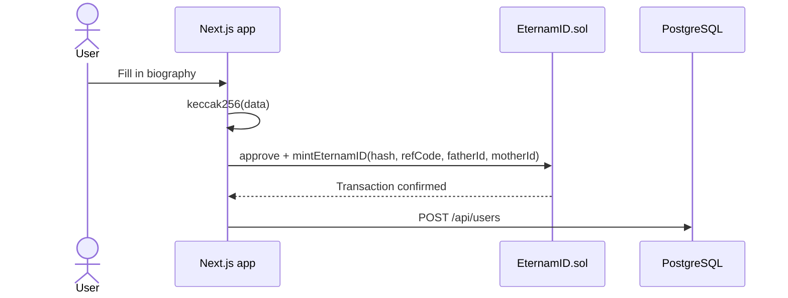

# EternamID

[](https://github.com/Zomirks/dapp-eternamID/actions/workflows/test.yml)


[](LICENSE)

EternamID preserves the memory of loved ones on-chain. Each ERC-721 token anchors a keccak256 fingerprint of a biography stored off-chain and can reference parent tokens to build a family tree. Mints are paid in a mock of USDC, with a pull-based referral programme.

Built solo in December 2025 as a full-stack dApp: smart contract, tests, CI, database and web interface.

## Live deployment

| | |
|---|---|
| Web app | [dapp-eternam-id.vercel.app](https://dapp-eternam-id.vercel.app) |
| `EternamID` contract (verified) | [`0x74d33B15d1D8FE26a5Ec7b656C6e2a735B8a4B13`](https://sepolia.etherscan.io/address/0x74d33B15d1D8FE26a5Ec7b656C6e2a735B8a4B13#code) |
| Mock USDC (`MockERC20`) | [`0xBDA13fB352Bc884E89D13ea67ac4ff7a91aD485f`](https://sepolia.etherscan.io/address/0xBDA13fB352Bc884E89D13ea67ac4ff7a91aD485f) |

> **Status:** the hosted database is currently disconnected, so off-chain profiles do not load in the web app. The contract and its on-chain data remain available on Sepolia.

> **Test token:** the project does not use real USDC. `MockERC20` is a 6-decimal mock of USDC with an open `mint` function, available from the faucet built into the app. It has no value.

## How it works

1. The user fills in a biography and may reference a father and a mother token.
2. The frontend hashes the data with keccak256.
3. The user approves 120 mock USDC and mints. The hash and parent links are stored on-chain.
4. Once the transaction is confirmed, the biography is saved to PostgreSQL.



## Smart contract

[`EternamID.sol`](backend/contracts/EternamID.sol) is an ERC-721 built on OpenZeppelin 5.

- **Mint:** 120 mock USDC per token. A data hash is required.
- **Referrals:** the owner issues referral codes. A referred mint credits 20 mock USDC to the referrer and 100 to the team.
- **Claims:** referrers and the team withdraw their balance with `claimBalance`.
- **Family tree:** each token can reference two parent tokens, exposed in its metadata.
- **Metadata:** the JSON is generated on-chain by `tokenURI`, with an SVG image stored on-chain and shared by all tokens.

## Technical decisions

| Decision | Reason |
|---|---|
| Biography off-chain, hash on-chain | Keeps personal data off the public ledger and storage costs low, while recording a fingerprint that cannot be changed |
| Pull payments (`claimBalance`) | Paying out never blocks a mint, and transfers are isolated in a single function |
| On-chain metadata | Token metadata depends on neither IPFS nor a server |
| Custom errors | Cheaper and more explicit reverts than revert strings |
| `ReentrancyGuardTransient` on claims, with checks-effects-interactions | Protects withdrawals using transient storage, which costs less gas than a storage-based guard |
| Stablecoin pricing | Keeps the mint price stable, unlike a price set in ETH |

## Testing

46 tests cover minting, parents, referrals, claims and metadata, with 93.6% line coverage on `EternamID.sol`. GitHub Actions runs the contract tests and a frontend type-check on every push to `main` and `dev`.

```bash
cd backend
npm install
npx hardhat test --coverage
```

## Known limitations

This project is a testnet demonstration. The contract has not been audited.

- Private notes are hidden in the UI only: the API routes have no authentication.
- If saving to the database fails after a mint, the token exists without its biography.
- The hash is computed client-side, is not salted, and is not re-checked by the server.
- The owner manages referral codes and can change a token's parents.
- Any existing token can be declared as a parent, and circular references between tokens are not prevented.

## Tech stack

| Layer | Tools |
|---|---|
| Smart contract | Solidity 0.8.28, Hardhat 3, OpenZeppelin, Hardhat Ignition, Ethers, Mocha, Chai |
| Frontend | Next.js 16, React 19, TypeScript, Tailwind CSS 4, Radix UI |
| Web3 | wagmi, viem, RainbowKit |
| Data | PostgreSQL, Prisma |
| Infrastructure | Vercel, GitHub Actions |

## Getting started

**Prerequisites:** Node.js 22, npm, a WalletConnect project ID and a PostgreSQL database.

```bash
git clone https://github.com/Zomirks/dapp-eternamID.git
cd dapp-eternamID/frontend
npm install
```

Create `frontend/.env`:

```bash
NEXT_PUBLIC_WALLETCONNECT_PROJECT_ID=
NEXT_PUBLIC_SEPOLIA_RPC_URL=
POSTGRES_PRISMA_URL=
POSTGRES_URL_NON_POOLING=
```

Then prepare the database and start the app, which connects to the Sepolia contracts:

```bash
npx prisma generate
npx prisma migrate deploy
npm run dev
```

To deploy your own contracts to Sepolia, from `backend`:

```bash
npm install
npx hardhat keystore set SEPOLIA_RPC_URL
npx hardhat keystore set SEPOLIA_PRIVATE_KEY
npx hardhat ignition deploy --network sepolia ignition/modules/EternamID.ts
```

The module also deploys the USDC mock. The resulting addresses then need to be updated in [`constants.ts`](frontend/src/utils/constants.ts).

## Project structure

```
backend/
├── contracts/    EternamID.sol, MockERC20.sol
├── ignition/     Deployment module and deployment history
└── test/         Contract tests
frontend/
├── prisma/       Database schema and migrations
└── src/          Next.js pages, API routes and components
```

## Author

Cyril Fischer · [GitHub](https://github.com/Zomirks)

## License

[MIT](LICENSE)
